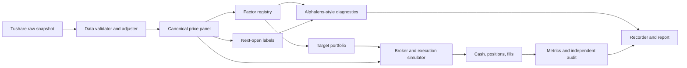

# 架构与设计边界

## 模块边界

| 模块 | 职责 | 禁止承担的职责 |
|---|---|---|
| `data.py` | 下载、校验、复权、快照和质量报告 | 不计算因子，不生成持仓 |
| `factors.py` | 纯因子公式、注册和统一长表 | 不读取账户状态，不计算费用 |
| `diagnostics.py` | 标签、IC、分组、换手与分布 | 不把重叠标签复利成净值 |
| `portfolio.py` | 将形成日分数映射为下一执行日目标权重 | 不假定成交成功 |
| `backtest.py` | 订单、成交、费用、现金和持仓状态机 | 不知道具体因子公式 |
| `metrics.py` | 收益、风险、成本和账本审计 | 不修改策略结果 |
| `recorder.py` | 记录配置、数据、源码、环境和产物哈希 | 不挑选最优结果 |
| `report.py` | 从已保存结果生成 PDF | 不手工写入绩效数字 |

## 借鉴与取舍

- Alphalens 的核心价值是统一因子输入和 tear-sheet 式诊断；本项目实现课程所需子集及因子换手，不引入旧版本依赖。
- Qlib 的核心价值是松耦合 workflow 和 recorder；本项目用小型配置驱动管线复现这一思想，不引入机器学习平台的额外复杂度。
- Backtrader 的核心价值是策略、Broker 和 Analyzer 分离；本项目保留事件顺序与订单账本思想，同时针对横截面 ETF 组合使用向量化数据接口。

## 时间顺序

1. 交易日 `t` 收盘后，仅使用截至 `t` 已完成的数据计算因子。
2. 目标权重记录 `signal_date=t`、`execution_date=t+1`。
3. `t+1` 开盘先卖后买，按实际成交额扣费。
4. `t+1` 收盘估值并计算当日净收益。
5. 流动性上限只使用 `t` 及以前的成交金额。

