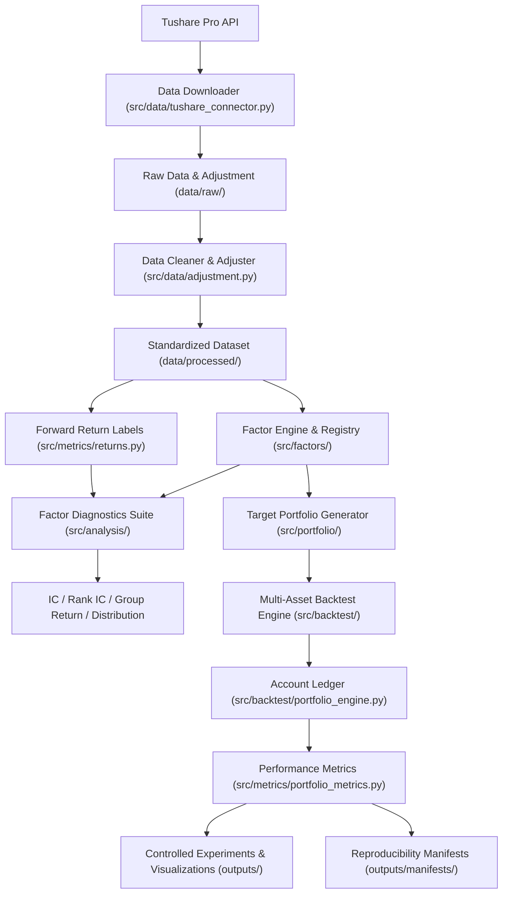

# System Architecture & Module Specifications (Sections 32 & 33)

## 1. System Architecture Diagram

---

## 2. Module Responsibilities & Design Boundaries (Section 33)

### 2.1 Data Downloader (`src/data/tushare_connector.py`, `src/data/data_downloader.py`)
- **职责**：与数据源（Tushare Pro）交互，拉取原始日线、复权因子，保存无损原始快照（Parquet/CSV）。
- **边界**：**绝不负责**特征计算、因子生成与回测逻辑。

### 2.2 Data Cleaner & Adjuster (`src/data/adjustment.py`, `src/data/validation.py`)
- **职责**：时间排序、主键唯一性 (`date × asset`) 校验、空值清洗、前复权计算，确立统一的数据模式（Schema）。
- **边界**：必须遵循固定的 `adjustment_reference_date`，切断跨标的未来数据污染。

### 2.3 Factor Engine (`src/factors/base_factor.py`, `src/factors/core_factors.py`, `src/factors/registry.py`)
- **职责**：将行情数据映射为纯粹的 Alpha 因子长表 (`date, asset, factor, raw_value, value, is_valid, preprocessing_version`)。
- **边界**：**绝不涉及**持仓、调仓手续费与资金管理，仅输出数学指标。

### 2.4 Factor Diagnostics (`src/analysis/factor_diagnostics.py`, `src/analysis/batch_diagnostics.py`)
- **职责**：计算横截面 Pearson IC、Spearman Rank IC、Rank IC IR、分层五组收益（Group Return K=5）、多空利差（High-Low Spread）及单调性检验。
- **边界**：必须与策略实际回测隔离，**绝不直接将分组收益复利**作为策略净值。

### 2.5 Portfolio Builder (`src/portfolio/target_portfolio.py`)
- **职责**：解析调仓频率（月度/周度），在调仓信号日 $t$ 筛选 Top N 标的并等权分配权重 ($1/N$)。
- **边界**：严格生成 $t \to t+1$ 生效的目标权重，杜绝前视偏差。

### 2.6 Backtest Engine & Ledger (`src/backtest/portfolio_engine.py`)
- **职责**：管理逐日账户状态机，根据生效目标权重执行买入/卖出调仓，扣除双边摩擦佣金，全程严格维持资金恒等式：
  $$\text{Equity} = \text{Cash} + \sum_{i} \text{Shares}_i \times P_{i,t}$$
- **边界**：纯粹由目标权重驱动，不干预因子的预测逻辑。

### 2.7 Performance Evaluator (`src/metrics/portfolio_metrics.py`)
- **职责**：计算年化净收益、年化波动率、夏普比率、最大回撤、总成本、单资产最大持仓权重，严格区分 Gross Return 与 Net Return。

### 2.8 Reproducibility System (`src/utils/reproducibility.py`)
- **职责**：记录全套软硬件运行指纹：`run_id`, `git_commit`, `config_hash`, `data_checksum`, `python_version`, 依赖包版本, `random_seed`, 时间戳。

---

## 3. Design Philosophy & Trade-offs
1. **Correctness > Reproducibility > Interpretability > Extensibility > Performance > Complexity**
2. 保持简单透明：第一阶段拒绝一切复杂的“黑盒”模型（无 ML、无复杂协方差优化），优先确保全流程在数学与会计学上的无懈可击。

