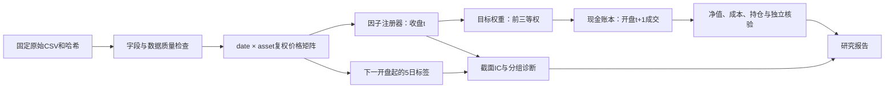

# CF2026 Project 1：可复现日频量化投研平台

完整任务：数据快照与质量报告、三个因子及IC/Rank IC/分组诊断、可配置回测、绩效与成本、周/月调仓对照，以及流动性预算和部分成交扩展。结果采用固定九只行业ETF、2015—2024年，不承诺因子能赚钱。

## 一键复现（默认离线数据）

安装Python 3.11及以上、uv。在解压后的本目录执行：

```powershell
uv sync --frozen
uv run --frozen python -m unittest discover -s tests -v
uv run --frozen python run.py
uv run --frozen python build_report.py
uv run --frozen python verify.py
```

首次安装依赖需要网络；已安装后回测直接使用随包固定快照，不访问行情接口。`uv.lock`锁定所有依赖。Windows若没有独立`uv`命令，可将`uv`替换为`python -m uv`。

研究报告：`output/pdf/CF2026_Project1_Report.pdf`；可编辑中文说明：`REPORT.md`；演示提纲：`DEMO.md`。`outputs/strategy_summary.csv`是绩效总表，`outputs/factor_summary.csv`是因子总表。CSV均为静态运行结果，修改配置后须重新运行，不会在Excel中自动求解。

原始快照在`data/raw/`，来源和SHA-256在`data/source_manifest.json`。如需重新获取同一版本：

```powershell
uv run --frozen python download_data.py
```

只有本地代理配置失效、且网络允许直连时才追加`--no-proxy`。下载器固定Git提交，不自动切换到最新数据；既有文件不同则拒绝覆盖。市场数据可能受原提供商使用条款约束，本包用于个人课程研究，未授予商业再分发许可。

## 如何调整配置

编辑`config.json`中的样本日期、资金、费率、持仓数、因子窗口、持有期、分组数及参与率，再运行。另存配置后可执行：

```powershell
uv run --frozen python run.py --config my_config.json --out outputs_custom
```

报告构建器读取默认`outputs`，自定义运行的数值保存在指定目录，避免旧报告冒充新配置结果。若要提交新配置报告，先将该配置作为默认配置运行完整流程。

## 架构与接口



|文件|职责|
|---|---|
|`src/data.py`|校验原始哈希、字段、唯一键和OHLC；不填零，不删除极端收益|
|`src/factors.py`|公式注册、长表输出、下一开盘标签、截面IC与形成时分组|
|`src/backtest.py`|独立现金和调整后单位账本、部分成交、绩效及审计|
|`run.py`|固定六组实验、图表、配置及源码版本记录|
|`tests/test_research.py`|小情景、故障注入、未来信息、公式和复现测试|
|`build_report.py`|从结果生成8页中文PDF和Markdown，不手写绩效数字|
|`verify.py`|离线重算、数值比对、测试与交付清单|

新增因子：在`src/factors.py`用`@register('name')`注册函数，配置其窗口；回测器只接收分数矩阵，不识别具体因子公式。当前实验清单显式固定于`run.py`，新增实验需要显式添加清单，不自动挑选历史最优者。

## 数据与交易的重要约定

- 数据是第三方保存的Yahoo格式已调整OHLC。源程序调用`stock.history(period="max")`，未保存独立原价、复权因子或下载时yfinance版本；因此复权口径有溯源限制。本项目不伪造缺失的原价/因子，也不再加一遍分红。
- 持仓以调整后价格单位计量，允许小数单位。它是总收益价格代理的研究账本，不是真实经纪商股数、除权登记和现金分红账本。
- 九只固定ETF不代表历史可投资全市场；未纳入退市资产和动态行业重组，不能声称完全消除了幸存者偏差。
- 信号在收盘后形成；周/月调仓在新周/月第一个样本交易日开盘执行，使用上一交易日分数。下单预算基于该次开盘价格的模拟成交/估值，假设可按开盘参考价完成价值配比。
- 双边各10bp是教学参数，费用按实际成交额扣除；99%投资预算保留缓冲。先卖后买，买入不足时同比缩放，不透支，不做空。
- 因子不足最低资产数时当次不调仓；缺开盘价则该资产不成交，未成交不收费。缺收盘价仅为已有持仓沿用上一估值并记日志，连续超过5个样本交易日则失败，不虚构退出价格。缺失价格不用于计算收益标签。
- 三分组按形成日分数排序，并列按代码稳定分配；IC/Rank IC的并列用平均秩。标签缺失只减少原组有效人数，不重分组。常数或少于6个资产的相关系数为缺失，不能写成0。
- 前向5日标签从t+1开盘至t+6开盘，末6天标签不完整；重叠标签只用于诊断，不直接复利成净值。
- 毛收益通过同配置零费率独立重跑，持仓规模可以因费用而不同。毛净差含再投资路径影响，不等于累计现金手续费。
- 扩展的成交额上限为前20个完整日“调整后收盘价×来源成交量”均值的0.1%。这是流动性压力代理，非真实历史美元成交额；未知复权因子和开盘容量会限制现实解释。未成交量当日取消，不假设之后自动成交。

## 交付与结果解释

`RESEARCH_PROTOCOL.md`记录看收益前固定的研究问题；全部已执行策略保留，不根据收益隐藏失败因子。报告使用描述性比较，未声明统计显著，也不将全样本固定规则研究称为独立样本外预测。AI参与了任务拆解、代码与文档草拟；使用者应亲自运行测试、理解账本并按课程要求披露，不能将此记录冒充其本人已经完成的复核。
