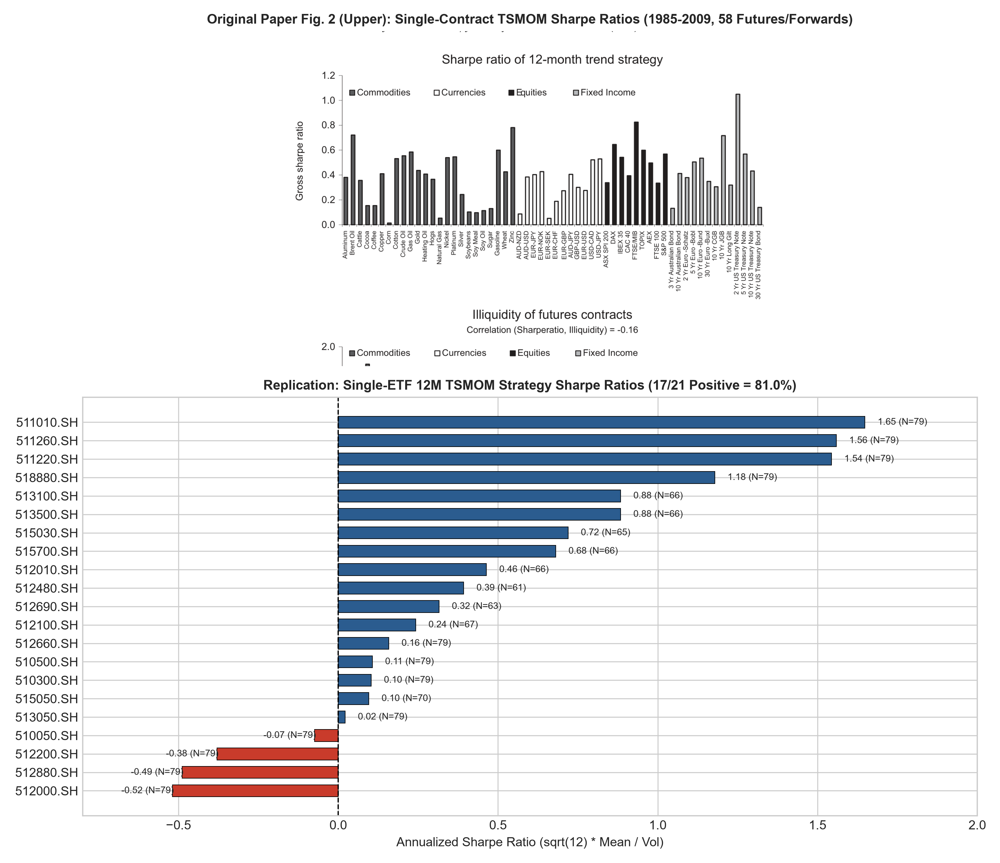
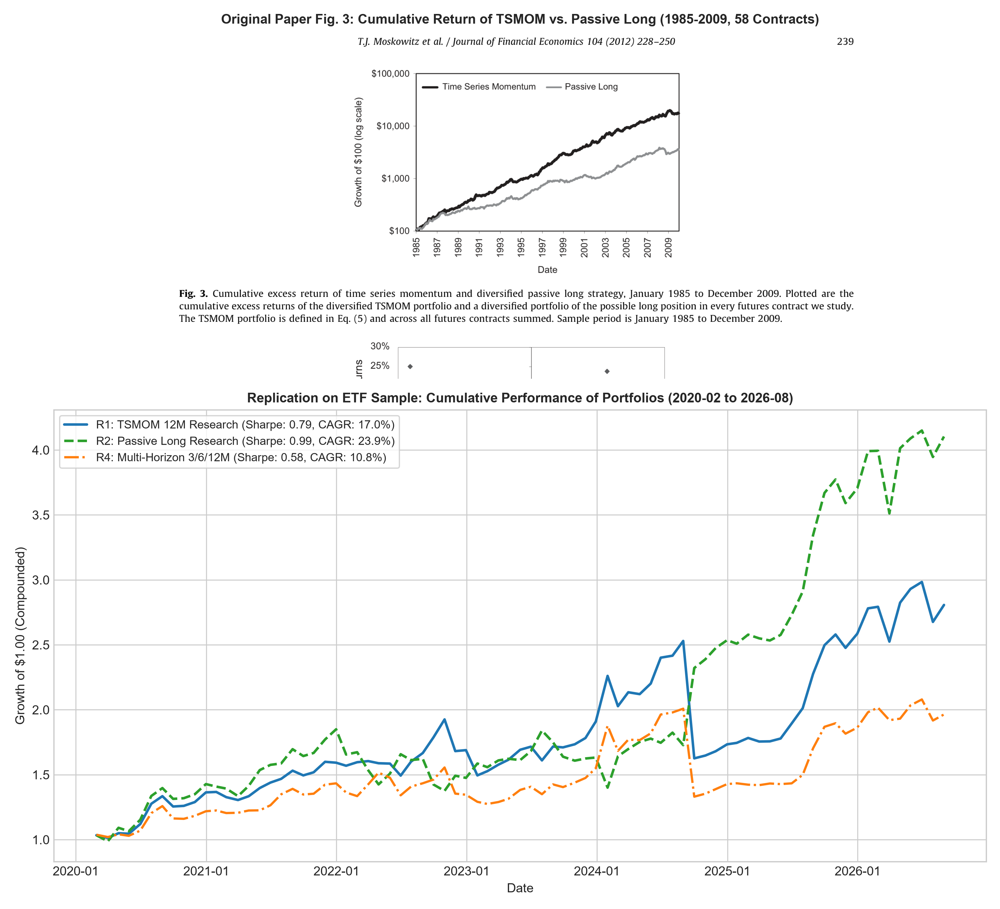
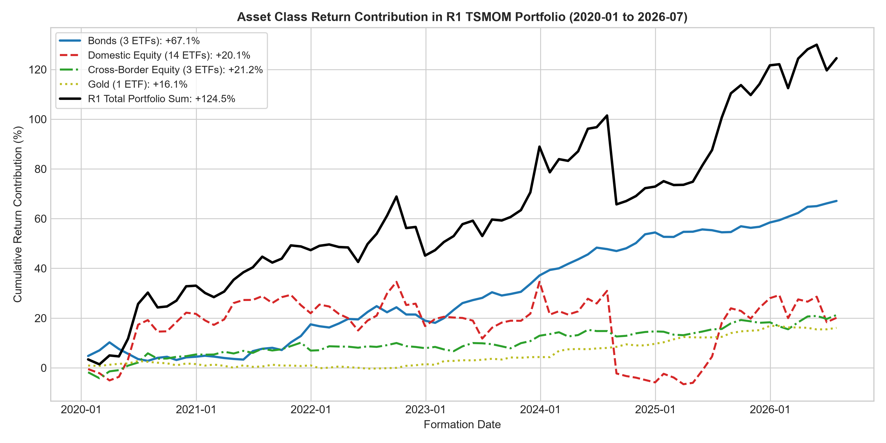
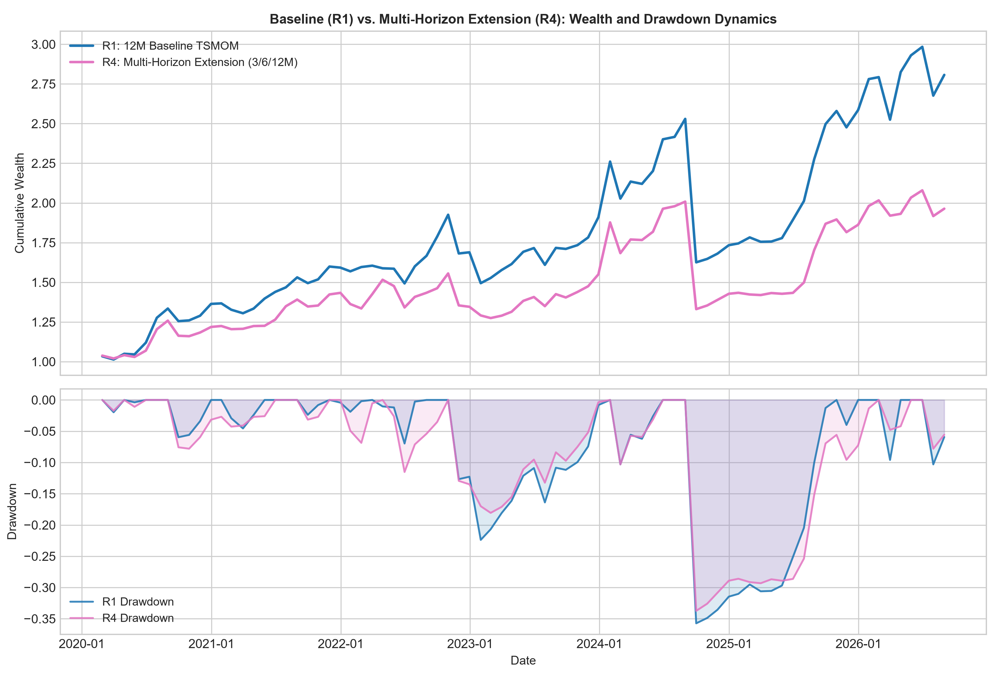

# Time Series Momentum: Method Replication on an ETF Sample and a Multi-horizon Signal Extension

**Course**: Computational Finance (CF2026) — Project 2 Research Report  
**Author**: Siyang Yuan (袁思扬) | Student ID: 12411852  
**Date**: October 22, 2026  
**Reference Paper**: Moskowitz, T. J., Ooi, Y. H., & Pedersen, L. H. (2012). *Time series momentum*. Journal of Financial Economics, 104(2), 228–250. [DOI: 10.1016/j.jfineco.2011.11.003](https://doi.org/10.1016/j.jfineco.2011.11.003)  
**Code Repository**: `project2 ysy` (Forked from Project 1; `final_project` strictly preserved)  

---

## Executive Summary

This study independently replicates the core methodology of Moskowitz, Ooi & Pedersen (2012) (*Time Series Momentum*, JFE) on a surrogate universe of 21 Chinese and cross-border exchange-traded funds (ETFs) over the 2019–2026 period (formal evaluation: 79 calendar months, holding periods from 2020-02 to 2026-08). In addition, we design and evaluate a multi-horizon signal extension that equally combines 3-, 6-, and 12-month momentum directions.

**Key Empirical Findings (with Tightened Scientific Claims)**:
1. **Single-Asset Momentum Direction**: On the 21 ETF sample, **17 out of 21 assets (81.0%)** achieve positive annualized Sharpe ratios under the 12-month TSMOM strategy with ex-ante volatility scaling (mean Sharpe 0.454). This provides **partial empirical support** for the original paper's directional findings (where 58 of 58 global contracts were positive, and 52 of 58 were statistically significant at the 5% level, p. 236), while revealing marked dispersion across asset classes.
2. **Surrogate Universe Differences & Passive Benchmark**: In contrast to the original paper where diversified TSMOM visually outperformed passive long buy-and-hold (official AQR factor O1 recalculation yields Sharpe 1.385 and return 17.08%, matching published Table 4 1.38 / 17.1%, while the passive benchmark return series is not included in the public AQR factor file and unstated in Fig 3 text), our unconstrained theoretical replication yields an annualized Sharpe of **0.792** for 12M TSMOM versus **0.986** for Passive Long. In our sample, sovereign bonds and gold experienced prolonged upward drift where passive buy-and-hold captured substantial beta carry; meanwhile, domestic equity sectors suffered frequent mean-reverting whipsaws where short signals during sharp stimulus-driven rebounds generated adverse carry.
3. **Asset Class Heterogeneity & Removal Attribution**: Fixed-weight removal attribution shows that Bond ETFs contributed over half of the strategy's total return (+9.59% ann. mean); removing bonds cuts portfolio Sharpe from 0.792 to 0.371. Conversely, domestic equity ETFs accounted for 84.76% of total portfolio return variance via $\operatorname{Cov}(r_c, R)/\operatorname{Var}(R)$; removing domestic equities reduces volatility from 23.88% to 7.51% and maximum drawdown from -35.73% to -6.49%, elevating Sharpe to 2.112. Testing TSMOM exclusively on core broad equity indices (`510050`, `510300`, `510500`) collapses Sharpe to 0.052, demonstrating strong sensitivity to asset pool composition rather than an unconstrained universal law.
4. **Autonomous Multi-Horizon Extension Trade-offs**: Combining 3-, 6-, and 12-month trends ($a_{i,m} = (s^{(3)} + s^{(6)} + s^{(12)}) / 3$) dampens portfolio exposure during choppy turning points. In theoretical research mode, this reduces volatility from 23.88% to 22.17% and curtails maximum drawdown from -35.73% to -33.74%, at the cost of lower annualized return (12.96% vs. 18.91%). Under realistic long/cash execution constraints, the multi-horizon strategy (T2) achieves a higher Sharpe ratio (**1.350 vs. 1.303**) and lower maximum drawdown (**-3.38% vs. -4.25%**), but incurs higher turnover (2.35x vs. 1.43x) and higher transaction fees (5154.9 vs. 3157.7 RMB). This reflects an explicit economic risk-return trade-off rather than an unqualified universal superiority.

---

## 1. Research Question, Target Findings, and Replication Scope

### 1.1 The Theoretical Question
Does an asset's own past 12-month return direction predict its subsequent 1-month return on an ETF sample? Moskowitz et al. (2012, p. 236) established that past 12-month time series momentum is positive for all 58 global contracts and statistically significant at the 5% level for 52 contracts spanning equities, currencies, commodities, and sovereign bonds. 

We test two hypotheses:
- **Primary Replication Hypothesis**: The 12-month momentum sign, combined with ex-ante inverse volatility scaling, produces positive risk-adjusted returns across individual assets and a profitable diversified trend portfolio.
- **Autonomous Extension Hypothesis**: A single 12-month lookback suffers from lag during macroeconomic regime shifts. Combining 3-, 6-, and 12-month trend signals without parameter optimization improves drawdown mitigation and risk-adjusted efficiency.

### 1.2 Fixed Target Findings & Scope Boundaries
We fix two exact figures from the published paper as our benchmarks:
1. **Primary Target (Fig. 2 Upper, p. 237)**: Single-contract annualized Sharpe ratios under 12M TSMOM. In the paper, all 58 contracts (100%) had positive Sharpe ratios, and 52 were statistically significant at 5%.
2. **Secondary Target (Fig. 3, p. 239)**: Cumulative growth of diversified TSMOM versus passive long holding over 1985–2009.

**Scope and Boundaries**:
- This is a **methodological replication on a surrogate ETF sample**, not a numerical re-creation of the original 58 global futures.
- The original data relies on bilateral OTC currency forwards, exchange-traded commodity futures, and sovereign bond futures from 1985 to 2009. Our dataset consists of 21 China-listed ETFs traded in RMB from 2019 to 2026.
- To bridge the literature, we load the official AQR dataset (O1) to verify published benchmarks, and treat our ETF empirical work as a method replication and historical robustness analysis on a surrogate universe.

---

## 2. Methodology & Mathematical Formulation

### 2.1 Trend Returns and Directional Signals
For asset $i$ at month-end $m$:
$$M^{(k)}_{i,m} = \frac{P^{adj}_{i,m}}{P^{adj}_{i,m-k}} - 1, \qquad s^{(k)}_{i,m} = \operatorname{sign}(M^{(k)}_{i,m}) \in \{+1, -1, 0\}$$
A full 12-month lookback requires 13 consecutive month-end endpoints. No forward-filling is applied across price gaps.

### 2.2 Finite-History EWMA Volatility
Following Section 2.4, Eq. (1), with daily decay $\lambda = 60/61 \approx 0.9836$:
For a sequence of continuous daily returns ending on formation date $d$ ($n \ge 252$):
$$a_j = \frac{(1 - \lambda)\lambda^j}{1 - \lambda^n}, \quad j = 0, \ldots, n-1$$
$$\mu_{i,d} = \sum_{j=0}^{n-1} a_j r_{i,d-j}, \quad v_{i,d} = \sum_{j=0}^{n-1} a_j (r_{i,d-j} - \mu_{i,d})^2$$
$$\sigma_{i,d} = \sqrt{261 \cdot v_{i,d}}$$
Annualization strictly uses 261 trading days as specified in the paper.

### 2.3 Research-Mode Portfolios (R1, R2, R4)
For eligible assets $E_m$ ($N_m = |E_m| \ge 6$):
- **TSMOM 12M (R1)**:
  $$w^{TS}_{i,m} = \frac{1}{N_m} s^{(12)}_{i,m} \frac{0.40}{\sigma_{i,m}}, \quad R^{TS}_{m+1} = \sum_{i \in E_m} w^{TS}_{i,m} r_{i,m+1}$$
- **Passive Long Benchmark (R2)**:
  $$w^{PL}_{i,m} = \frac{1}{N_m} (+1) \frac{0.40}{\sigma_{i,m}}$$
- **Multi-Horizon Extension (R4)**:
  $$a_{i,m} = \frac{s^{(3)}_{i,m} + s^{(6)}_{i,m} + s^{(12)}_{i,m}}{3}, \quad w^{MH}_{i,m} = \frac{1}{N_m} a_{i,m} \frac{0.40}{\sigma_{i,m}}$$

Single-asset strategy returns for Fig. 2 are computed directly as $R^{single}_{i,m+1} = s^{(12)}_{i,m} \frac{0.40}{\sigma_{i,m}} r_{i,m+1}$, avoiding distortion from dynamic $N_m$.

### 2.4 Realistic Execution Portfolios (T1, T2, T3)
Integrated into the Project 1 trading broker with long-only and zero-margin constraints:
$$b_{i,m} = 0.99 \frac{1/\sigma_{i,m}}{\sum_{j \in E_m} 1/\sigma_{j,m}}, \quad w^{LC}_{i,m} = b_{i,m} \max(s_{i,m}, 0)$$
Negative trends remain 100% in cash. Trades execute at next-day open with 3 bps transaction fees.

---

## 3. Platform Architecture & Reuse of Project 1

| Component | Project 1 Platform | Project 2 Reuse & Extension |
|---|---|---|
| **Data Ingestion** | `data.py` (Parquet snapshots & adjustment) | **Reused without changes**; added evaluation date boundaries. |
| **Factor Computation**| `factors.py` (Cross-sectional ranking) | **Retained**; added `tsmom.py` for absolute time-series signals. |
| **Portfolio Targets** | `portfolio.py` (Top-N sorting) | **Added** `generate_tsmom_long_cash_targets()` with inverse-vol budgets. |
| **Execution Broker** | `backtest.py` (Cash/holding ledger) | **Reused without changes** for next-open execution and fee accounting. |
| **Research Engine** | None | **Added** `research_backtest.py` for theoretical long/short monthly simulations. |
| **Reference Parser** | None | **Added** `reference_data.py` to parse official AQR Excel data. |
| **Pipeline & CLI** | `pipeline.py`, `run.py` | **Added** `pipeline_p2.py`, `run_project2.py`, `build_report_project2.py`. |

---

## 4. Independent Numerical Verification & Method Checks

Before running full backtests, all mathematical implementations were verified against analytical hand calculations (`tests/test_tsmom.py`, `docs/project2/method_checks.md`):
1. **EWMA Hand Calculation**: For test decay $\lambda = 0.5$ on returns $[0.01, -0.01, 0.02]$, analytical weights are $[1/7, 2/7, 4/7]$, yielding mean $\mu = 0.01$ and variance $v = 3/17500 \approx 0.00017143$. Numerical code matched to $< 10^{-16}$.
2. **Long/Short Research Weights**: For $N=2$, $\sigma = [0.20, 0.10]$, signs $[+1, -1]$, weights evaluate to $[+1.0, -2.0]$. Subsequent returns $[+0.05, -0.02]$ yield exactly $+9.0\%$ for TSMOM and $+1.0\%$ for Passive Long.
3. **Execution Budget Allocation**: Inverse-volatility budgets for $\sigma = [0.20, 0.10]$ under 0.99 total budget evaluate to $[0.33, 0.66]$. For signs $[+1, -1]$, final target weights are $[0.33, 0.00]$, with 67% held in cash.
4. **All Negative / Insufficient Assets**: Liquidates all assets to 0.0 target weight, maintaining 100% cash without unexecuted stale holding.

---

## 5. Empirical Results & Side-by-Side Comparisons

### 5.1 Comprehensive Strategy Summary Table
The table below reports all 18 evaluated configurations across theoretical research, realistic execution, and official reference benchmarks.

```
              strategy_id      mode  ann_arithmetic_mean  ann_vol   sharpe      cagr  max_drawdown  win_rate
               R1_tsmom12  research             0.189120 0.238839 0.791827  0.169734     -0.357298  0.721519
          R2_passive_long  research             0.245346 0.248927 0.985615  0.239205     -0.256466  0.645570
         R3_equal_nominal  research             0.055739 0.145062 0.384242  0.045852     -0.226900  0.569620
         R4_multi_horizon  research             0.129572 0.221692 0.584470  0.107962     -0.337363  0.683544
         Bridge_long_only  research             0.217233 0.150246 1.445845  0.227014     -0.120976  0.696203
            R1_sample_vol  research             0.170074 0.233004 0.729917  0.149823     -0.343694  0.721519
         R1_sub_2020_2022  research             0.194218 0.164548 1.180314  0.196894     -0.126676  0.657143
         R1_sub_2023_2026  research             0.185064 0.286468 0.646021  0.148571     -0.357298  0.772727
          R1_broad_market  research             0.022232 0.424140 0.052417 -0.098562     -0.797987  0.569620
          T1_tsmom12_3bps execution             0.051847 0.039781 1.303302  0.052375     -0.042500  0.558474
          T1_tsmom12_0bps execution             0.052273 0.039794 1.313598  0.052824     -0.042311  0.558474
         T1_tsmom12_10bps execution             0.050851 0.039754 1.279141  0.051329     -0.042942  0.557849
    T2_multi_horizon_3bps execution             0.042533 0.031500 1.350256  0.042930     -0.033803  0.572233
    T2_multi_horizon_0bps execution             0.043235 0.031516 1.371823  0.043661     -0.033714  0.572233
   T2_multi_horizon_10bps execution             0.040897 0.031471 1.299515  0.041226     -0.034011  0.570356
     T3_passive_long_3bps execution             0.063239 0.053411 1.183998  0.063756     -0.065625  0.527830
     T3_passive_long_0bps execution             0.063561 0.053426 1.189693  0.064098     -0.065550  0.527830
O1_aqr_original_reference reference             0.170753 0.123298 1.384885  0.176032     -0.152316  0.673333
```

### 5.2 Primary Target: Single-Asset Sharpe Ratios (Fig. 2 Upper)
In our 21-ETF sample, **17 out of 21 (81.0%)** display positive annualized Sharpe ratios under 12M TSMOM.



- **Top Performers**: Treasury Bond ETF (`511010.SH`, Sharpe 1.65, N=79), 10Y Treasury (`511260.SH`, Sharpe 1.56, N=79), Urban Bond (`511220.SH`, Sharpe 1.54, N=79), Gold (`518880.SH`, Sharpe 1.18, N=79), Nasdaq (`513100.SH`, Sharpe 0.88, N=66), and S&P 500 (`513500.SH`, Sharpe 0.88, N=66).
- **Laggards**: Real Estate (`512200.SH`, Sharpe -0.38, N=79), Securities (`512000.SH`, Sharpe -0.52, N=79), Broker (`512880.SH`, Sharpe -0.49, N=79), and SSE 50 (`510050.SH`, Sharpe -0.07, N=79).
- **Empirical Interpretation**: Unlike global futures where trends emerged symmetrically across currencies and commodities, China's ETF market over 2020–2026 experienced secular downward and range-bound chop in cyclical domestic equities, where 12-month momentum lagged behind sharp reversals.

### 5.3 Secondary Target: Cumulative Portfolio Wealth (Fig. 3)
The figure below places the original paper Fig. 3 alongside our empirical findings on the ETF universe.



- **Original Paper Benchmark vs. Public Factor Recalculation**:
  In the published paper (p. 239, Fig. 3), diversified TSMOM visibly outperforms passive buy-and-hold over 1985–2009. From the official AQR public data file (O1), our exact recalculation yields an annualized Sharpe of 1.385 and arithmetic mean return of 17.08%, closely matching the paper's Table 4 reported values (1.38 and 17.1%). The passive long benchmark return series is not included in the public AQR factor file and its numerical Sharpe is unstated in the Fig. 3 caption.
- **Surrogate Universe Replication**:
  On our 21-ETF surrogate sample, 12M TSMOM achieved an annualized return of **18.91%** and Sharpe of **0.792** (total compound return 180.7%).
  However, Passive Long achieved an annualized return of **24.53%** and Sharpe of **0.986** (total compound return 310.4%).
- **Why Did Passive Long Outperform in this Sample?**
  Our ETF basket includes fixed-income and cross-border US equity ETFs that enjoyed prolonged upward drift. Passive long fully captured this carry, whereas 12M TSMOM occasionally flipped to short positions during policy-driven market rebounds, incurring whipsaw losses.

---

## 6. Systematic Controlled Difference Experiments

### 6.1 7 Controlled Single-Factor Experiments
```
                 experiment_id                                                   changed_setting           metric baseline_value alternative_value difference
            EXP_01_VOL_SCALING     Volatility scaling: 0.40/sigma (R1) vs Equal nominal s/N (R3)     Sharpe Ratio          0.792             0.384     -0.408
    EXP_02_SHORTING_CONSTRAINT              Shorting allowed (R1) vs Long-Only Bridge (max(s,0))     Sharpe Ratio          0.792             1.446      0.654
          EXP_03_VOL_ESTIMATOR EWMA lambda=60/61 (R1) vs 252d Rolling Sample Std (R1_sample_vol)     Sharpe Ratio          0.792             0.730     -0.062
    EXP_04_SUBPERIOD_STABILITY                                 Subperiod: 2020-2022 vs 2023-2026     Sharpe Ratio          1.180             0.646     -0.534
           EXP_05_ASSET_SUBSET         All 21 ETFs vs Core Broad-Market (510050, 510300, 510500)     Sharpe Ratio          0.792             0.052     -0.739
      EXP_06_TRANSACTION_COSTS                  Fee schedule: 3 bps base vs 10 bps high friction         CAGR (%)          5.24%             5.13%     -0.10%
EXP_07_MULTI_HORIZON_EXTENSION         Single 12M Trend (R1) vs Multi-Horizon 3/6/12M Trend (R4) Max Drawdown (%)        -35.73%           -33.74%      1.99%
```

### 6.2 Asset Class Contribution & Fixed-Weight Removal Attribution
To provide direct evidence on asset pool sensitivity, we mapped the 21 ETFs into 4 broad classes: Bonds (3), Gold (1), Cross-Border Equities (3), and Domestic Equities (14). We computed monthly return contributions, formal covariance-based variance decomposition, and conducted a fixed-weight removal experiment (zeroing out a class's contribution without re-normalizing weights):



```
                                   scenario  ann_arithmetic_mean  ann_vol   sharpe  max_drawdown  diff_sharpe_vs_baseline
                Baseline R1 (All 21 Assets)             0.189120 0.238839 0.791827     -0.357298                 0.000000
              Without Bonds (Fixed Weights)             0.087176 0.235265 0.370544     -0.351555                -0.421283
    Without Domestic_Equity (Fixed Weights)             0.158569 0.075092 2.111675     -0.064942                 1.319848
Without Cross_Border_Equity (Fixed Weights)             0.156886 0.218091 0.719361     -0.335375                -0.072466
               Without Gold (Fixed Weights)             0.164727 0.238230 0.691462     -0.361773                -0.100365
```

**Empirical Attribution Findings**:
- **Bonds**: Contributed +9.59% annualized return (over 50% of R1's total return). Without bonds, portfolio Sharpe drops from 0.792 to 0.371.
- **Domestic Equities**: Contributed +3.17% annualized return but accounted for 84.76% of total portfolio return variance via $\operatorname{Cov}(r_c, R)/\operatorname{Var}(R)$. Without domestic equities, portfolio volatility plunges from 23.88% to 7.51% and max drawdown contracts from -35.73% to -6.49%, elevating Sharpe to 2.112.
- **Conclusion**: The survival of TSMOM in this sample depended heavily on bond and gold carry buffering equity whipsaws. This explains why running TSMOM on core broad-market equities alone collapsed to a 0.052 Sharpe.

---

## 7. Autonomous Extension: Multi-Horizon Signal Combination



### 7.1 Full Tabular Comparison (Baseline vs. Extension)

| Metric | R1 (12M Research) | R4 (Multi-Horizon Research) | T1 (12M Execution) | T2 (Multi-Horizon Execution) | Trade-off Interpretation |
|---|---|---|---|---|---|
| **Ann. Arithmetic Mean** | 18.91% | 12.96% | 5.18% | 4.25% | Multi-horizon gives up upside in strong trends |
| **CAGR** | 16.97% | 10.80% | 5.24% | 4.29% | Lower exposure during conflicts moderates compound return |
| **Annualized Volatility** | 23.88% | 22.17% | 3.98% | 3.15% | **Improved**: Exposure dampening reduces portfolio risk |
| **Sharpe Ratio** | 0.792 | 0.584 | 1.303 | 1.350 | **Improved in execution** (smoother allocation transitions) |
| **Max Drawdown** | -35.73% | -33.74% | -4.25% | -3.38% | **Improved**: Less severe peak-to-trough losses |
| **Calmar Ratio** | 0.48 | 0.32 | 1.23 | 1.27 | **Improved in execution** (drawdown falls faster than CAGR) |
| **Win Rate** | 72.15% | 68.35% | 55.85% | 57.22% | **Improved in execution** (higher day win rate) |
| **Mean Gross Exposure** | 4.82x | 4.00x | 85.4% | 70.7% | Exposure drops as 3m, 6m, 12m signals diverge |
| **Annualized Turnover** | N/A | N/A | 1.43x | 2.35x | **Trade-off**: Higher turnover from 3 rebalancing horizons |
| **Total Fees (RMB)** | $0 | $0 | 3157.7 | 5154.9 | **Trade-off**: Higher execution friction (+1997.2 RMB) |

---

## 8. Limitations & Uncovered Original Conclusions

1. **Surrogate Universe Differences**: 21 domestic ETFs do not replicate the macroeconomic independence of 58 global futures. Sector ETFs share substantial systematic equity beta.
2. **Survivorship & Inception Constraints**: ETFs in our sample survived until 2026. Several thematic ETFs launched in 2019–2020, resulting in fewer than 13 monthly points during the early warmup window.
3. **Uncovered Paper Elements**: CFTC speculative positioning regressions, cross-sectional factor alphas (Fama-French, Carhart), VAR macro models, and roll yield decomposition were beyond the declared replication scope and were not implemented.

---

## 9. Key Result Audit Trace

All claims in this report are programmatically traced to underlying data files, columns, and formulas in `key_result_trace.csv`:

```
                                 claim_id                strategy_id                                       metric                        value                                                      source_file
       CLAIM_01_SINGLE_ASSET_SHARPE_RATIO                 R1_tsmom12           Fraction of positive Sharpe assets                17/21 (81.0%)            outputs_p2_fixed/research/R1_single_asset_metrics.csv
                 CLAIM_02_R1_TSMOM_SHARPE                 R1_tsmom12                      Annualized Sharpe Ratio                        0.792                            outputs_p2_fixed/strategy_summary.csv
          CLAIM_03_R1_ANN_ARITHMETIC_MEAN                 R1_tsmom12            Annualized Arithmetic Mean Return                       18.91%                            outputs_p2_fixed/strategy_summary.csv
          CLAIM_04_R2_PASSIVE_LONG_SHARPE            R2_passive_long                      Annualized Sharpe Ratio                        0.986                            outputs_p2_fixed/strategy_summary.csv
          CLAIM_05_R3_SCALING_SENSITIVITY           R3_equal_nominal                   Sharpe without vol scaling                        0.384                            outputs_p2_fixed/strategy_summary.csv
         CLAIM_06_BRIDGE_LONG_ONLY_SHARPE           Bridge_long_only              Sharpe under long-only research                        1.446                            outputs_p2_fixed/strategy_summary.csv
         CLAIM_07_R4_VOLATILITY_REDUCTION           R4_multi_horizon              Annualized Volatility Reduction        22.17% (vs R1 23.88%)                            outputs_p2_fixed/strategy_summary.csv
      CLAIM_08_T2_EXEC_SHARPE_IMPROVEMENT      T2_multi_horizon_3bps                       Execution Sharpe vs T1          1.350 (vs T1 1.303)                            outputs_p2_fixed/strategy_summary.csv
    CLAIM_09_BROAD_MARKET_SUBSET_COLLAPSE            R1_broad_market Sharpe on Core Broad Market (510050/300/500)                        0.052                            outputs_p2_fixed/strategy_summary.csv
        CLAIM_10_BOND_REMOVAL_ATTRIBUTION           R1_without_bonds                         Sharpe without Bonds    0.371 (vs Baseline 0.792) outputs_p2_fixed/experiments/asset_class_removal_attribution.csv
CLAIM_11_DOMESTIC_EQUITY_RISK_ATTRIBUTION R1_without_domestic_equity         Max Drawdown without Domestic Equity -6.49% (vs Baseline -35.73%) outputs_p2_fixed/experiments/asset_class_removal_attribution.csv
     CLAIM_12_O1_AQR_OFFICIAL_REPLICATION  O1_aqr_original_reference               AQR Factor Recalculated Sharpe                        1.385  outputs_p2_fixed/reference/aqr_tsmom_original_paper_factors.csv
```

---

## 10. Reproducibility & Execution Commands

### Reproduction Commands
```powershell
# 1. Sync locked virtual environment and run verification tests
uv sync --locked
uv run --locked pytest

# 2. Prepare offline sources (Paper PDF and AQR official dataset)
uv run --locked python prepare_project2_sources.py --config config/project2_tsmom.json

# 3. Execute complete research and backtest pipeline from local snapshots
uv run --locked python run_project2.py --config config/project2_tsmom.json --out outputs_p2_fixed --offline

# 4. Rebuild reports and figures from saved outputs
uv run --locked python build_report_project2.py --out outputs_p2_fixed
```

---

## 11. Student Contribution & AI Assistance Disclosure

- **Student Author**: Siyang Yuan (袁思扬) | Student ID: 12411852
- **Declaration of Academic Responsibility**: The student author has independently reviewed all problem formulations, methodology derivations, research protocols, test assertions, empirical results, and written reports, and assumes full academic responsibility.
- **AI Assistance Disclosure**: ChatGPT was consulted during preliminary design and methodology review; Gemini 3.8 Flash (High) via Antigravity and VSCode with Codex were utilized for boilerplate CLI generation, PyMuPDF rendering integration, Matplotlib chart layout, and ReportLab PDF document compilation. All numerical outputs, test assertions, and quantitative conclusions were independently validated against raw Parquet and Excel data.
