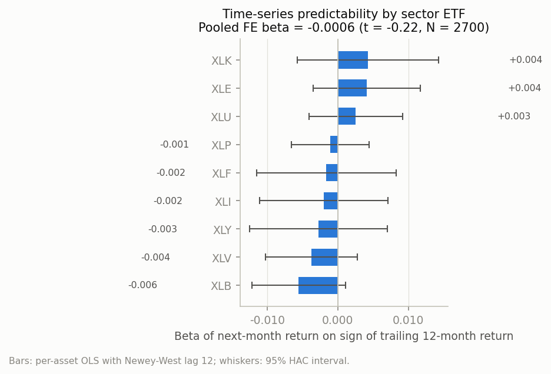
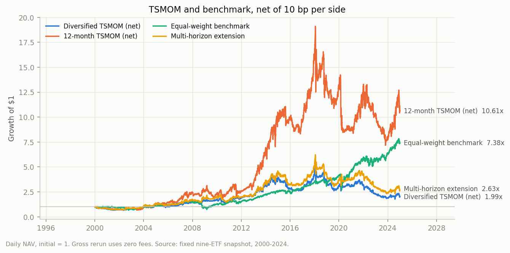
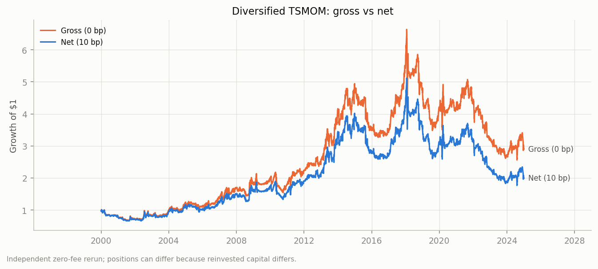
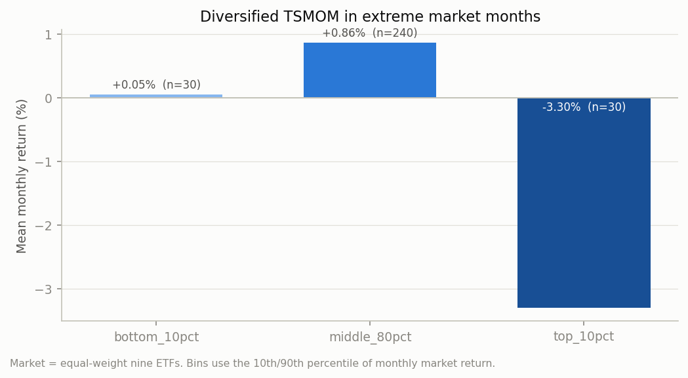
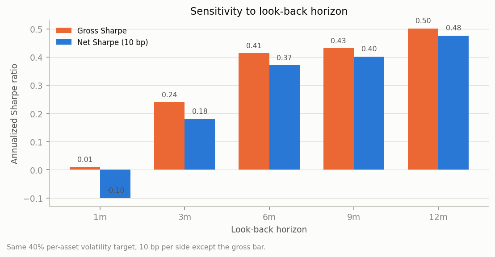
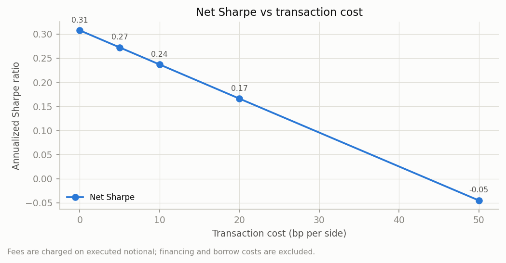
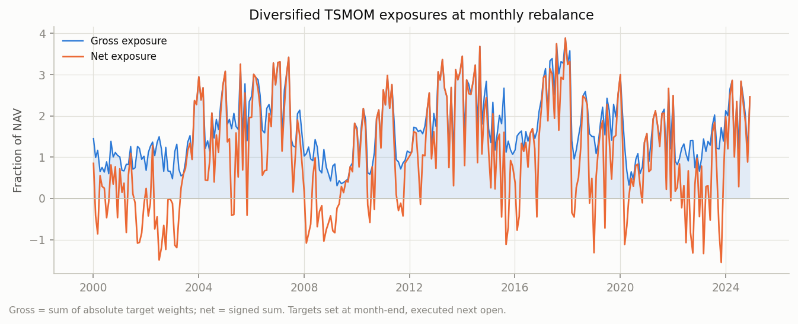

# CF2026 Project 2 复现报告

## Time Series Momentum（Moskowitz, Ooi & Pedersen, 2012）

**平台**：Project 1 的 9 只美国行业 SPDR ETF 固定快照
**样本**：2000-01-03 至 2024-12-31（300 个月，6,289 个交易日）
**代码/数据**：`run.py`、`src/`、`config.json`、`data/`
**运行证据**：`outputs/`、`outputs/audit.json`、`outputs/run_manifest.json`、
`outputs/verification.json`

---

## 摘要

本文在 Project 1 平台上复现 Moskowitz, Ooi & Pedersen (2012) 的核心结论：
过去 1–12 个月收益的符号能否预测下一期收益，以及 1/3/12 个月 TSMOM 的多元化
组合能否产生高 Sharpe 和显著 alpha。

**结论：在 9 只美国行业 ETF、2000–2024 的样本上，原文的核心结论没有复现。**

主要证据：

1. **可预测性为零，符号甚至为负。** 12 个月符号对下月收益的 pooled 固定效应
   回归：\(\beta=-0.000614\)，HAC \(t=-0.22\)，\(R^2=0.000093\)，\(N=2{,}700\)。
   正符号后的下月平均收益为 **0.7355%**，负符号后为 **0.8576%**，差
   **-0.1220%/月**（\(t=-0.23\)）。1、3、6、24 个月的 pooled β 也都不显著，
   其中 1、3、12、24 个月为负。
2. **组合 Sharpe 远低于原文。** 多元化 TSMOM 的月频 Sharpe 为
   **0.325（gross）/ 0.242（net 10 bp）**，12 个月 TSMOM 为 **0.528（net）**；
   原文多元化组合约 **1.01（gross）**。同期等权基准的月频 Sharpe 为 **0.610**，
   高于所有 TSMOM 变体（除 long-only 诊断腿的 0.656）。
3. **相对等权基准的 alpha 不显著。** 多元化 net alpha = **4.13%/年**
   （\(t=1.04\)）；12 个月 net alpha = **8.03%/年**（\(t=1.75\)）。
4. **极端月份与原文相反。** 市场最低 10% 月份 TSMOM 平均 **+0.05%**
   （\(t=0.03\)），最高 10% 月份 **-3.30%**（\(t=-3.50\)）。原文的
   “smile”/危机 alpha 没有出现；策略在 V 形复苏中因持有多头而受损。
5. **原因是结构性的，不是代码失败。** 账本恒等式最大误差 **1.68e-8**，
   单元测试与手算复核通过。9 只 ETF 同属美国股票，平均两两相关
   **0.609（日频）/0.564（月频）**；long-only 腿 Sharpe 0.656，
   short-only 腿 **-0.557**，long-short 组合被空头腿拖累。原文的 58 个期货、
   4 大资产类别、跨资产分散和期货展期收益在本文平台上无法重建。

因此，本文保留负结果，并把差异拆分为：数据/样本、预处理/交易、原文未指定、
实现误差和未能解释的残差。详细归因见
[DIFFERENCE_ATTRIBUTION.md](DIFFERENCE_ATTRIBUTION.md)。

---

## 1. 任务、原文与复现范围

### 1.1 原文

- Moskowitz, Ooi & Pedersen (2012), “Time Series Momentum”,
  *Journal of Financial Economics* 104(2), 228–250。
- 原文在 **58 个期货/远期合约、4 大资产类别**（商品、股票指数、债券、外汇）、
  **1965–2009** 上研究单个资产自身过去收益的持续性。
- 核心结论：过去 1–12 个月收益的符号正向预测下一期收益；1/3/12 个月 TSMOM
  等权组合的 gross Sharpe 约 **1.01**，组合年化波动率约 **12%**；极端市场
  月份表现良好（Table 3）。

### 1.2 为什么选这篇论文

Project 1 平台只有 9 只美国行业 ETF。TSMOM 是**逐资产**构造，不依赖横截面上
大量资产的排序，因此在 9 个资产上仍可做有意义的复现；相比之下，横截面动量
需要更宽的横截面。原文的方法足够清晰（信号、波动率缩放、1/N、月度再平衡），
同时保留了几个必须显式选择的细节，适合做“理解 + 实现 + 验证 + 解释”的
Project 2。

### 1.3 复现范围

本文复现一个核心结论，而不是原文全部表格：

- 12 个月符号的逐资产与 pooled 可预测性；
- 1/3/12 多元化 TSMOM 的收益、波动、Sharpe、回撤、换手、暴露；
- 相对等权基准的 alpha；
- 极端市场月份；
- lookback、成本、波动率目标、子样本、无风险利率的稳健性；
- 单因子自扩展：加入 6 个月、12-1 skip-month、long-only/short-only、
  12% 组合波动率缩放。

不复制：58 个期货的完整数据、商品/债券/外汇、CFTC 持仓、原文的模拟组合与
全套因子 alpha。这些正是后文归因的核心。

---

## 2. 数据与平台

### 2.1 数据快照

| 项目 | 值 |
|---|---|
| 资产 | XLB, XLE, XLF, XLI, XLK, XLP, XLU, XLV, XLY |
| 来源 | 公开 GitHub 快照 `miguel-merlin/etf-directional-forecasting`，commit `b3b583b` |
| 价格 | 已调整 OHLC（无独立股息现金流） |
| 原始行数 | 61,407（9 × 6,823） |
| 清洗后行数 | 58,932（9 × 6,548） |
| 原始区间 | 1998-12-22 至 2024-12-31 |
| 研究区间 | 2000-01-03 至 2024-12-31 |
| 固定网格缺失 close | 0 |
| 重复键 / 非法行 | 0 / 0 |
| 零成交量 | 1（XLI，单日） |
| SHA-256 | 逐个文件校验，见 `data/source_manifest.json` |

数据来源、字段、清洗与限制详见 [DATA.md](DATA.md)。

### 2.2 Project 1 复用与新增

| 模块 | 来源 | 说明 |
|---|---|---|
| `src/data.py` | P1 复用 | 原始 CSV → 校验 → 固定网格；新增显式 `warmup_start`，让 12 个月信号和 60 日 EWMA 在 2000-01 前预热 |
| `src/backtest.py` | P1 扩展 | P1 为 long-only、自融资；本目录允许负 units/负现金、做空、按成交 notional 的绝对值收双边费用，并保留逐日审计 |
| `src/plots.py` | P1 风格复用 | 浅色表面、固定分类色序、直接标注、单一坐标轴 |
| `config.json` | P1 思路 | 所有参数外置；运行清单记录配置/代码哈希 |
| `src/tsmom.py` | **新增** | 符号信号、多期限、EWMA 波动率/协方差、40% 单资产目标、1/N、gross cap |
| `src/stats.py` | **新增** | HAC/Newey–West、pooled FE、月份聚类、alpha、极值月份 |
| `tests/`、`verify.py` | **新增** | 单元测试、重跑对比、账本一致性 |

### 2.3 账本与审计

日频账本 `simulate()` 的时序契约：

1. 月末收盘 \(t\) 形成信号；
2. 下一交易日 \(t+1\) 开盘执行目标权重；
3. 每日收盘盯市；
4. 费用按执行的 notional 收取（买入/卖出各 10 bp 基线）；
5. 允许负 units 与负现金（做空）；
6. 不建模融资、借券、保证金、卖空 locate。

`audit()` 检查以下恒等式，任何一项超过 `1e-5` 即报错：

| 检查 | 最大误差（所有策略） |
|---|---|
| 日收益与 NAV 变化 | 2.22e-16 |
| 复利与终端 NAV | 1.05e-13 |
| NAV 定义 | 0 |
| 成本非负 | 0 |
| 换手定义 | 0 |
| 现金账本 | 1.68e-8 |
| 费用求和 | 1.16e-10 |

完整结果在 `outputs/audit.json`。

---

## 3. 方法

### 3.1 信号

对资产 \(i\)、月末 \(t\)、期限 \(h\)：

\[
r^{(h)}_{i,t}=\frac{P_{i,t}}{P_{i,t-h}}-1,\qquad
s^{(h)}_{i,t}=\operatorname{sign}\left(r^{(h)}_{i,t}\right).
\]

基线 \(h=12\)；多元化组合同时使用 \(h=1,3,12\)。

### 3.2 波动率与权重

\[
w^{(h)}_{i,t}=\frac{1}{N_t}\cdot\frac{0.40}{\sigma_{i,t}}\cdot s^{(h)}_{i,t},
\]

- \(\sigma_{i,t}\)：日频收益 EWMA 年化波动率，center of mass 60 天；
- \(N_t\)：当期可用资产数（本样本通常为 9，最少要求 6）；
- 40% 是**单资产**波动率目标，不是组合目标；
- 1/N 让组合在资产间等权。

多元化组合：

\[
w^{\text{div}}_{i,t}=\frac{1}{3}\left(w^{(1)}_{i,t}+w^{(3)}_{i,t}+w^{(12)}_{i,t}\right).
\]

### 3.3 执行与成本

- 月末收盘形成信号，下一交易日**开盘**执行；
- 月度再平衡；
- 基线 10 bp/边；敏感性 0/5/10/20/50 bp；
- 不做组合层的 12% 波动率缩放（只作为诊断变体）。

### 3.4 统计

- 逐资产：下月收益对符号的 OLS，Newey–West/HAC lag 12；
- pooled：资产固定效应（within 去均值），标准误按月份聚类；
- alpha：组合月收益对等权基准回归，截距×12 年化，HAC lag 12；
- 极端月份：按等权市场月收益取 10%/20% 分尾，报告均值与 HAC t；
- Sharpe：月频为 \( \sqrt{12}\cdot \bar r / s_r \)；日频为
  \( \sqrt{252}\cdot \bar r / s_r \)。与原文比较时使用**月频**。

---

## 4. 可比口径与原文目标

| 维度 | 原文 | 本文 |
|---|---|---|
| 资产池 | 58 个期货/远期，4 大资产类别 | 9 只美国行业 ETF，1 个资产类别 |
| 样本 | 1965–2009 | 2000–2024（原文之后的样本外） |
| 信号 | 过去 1/3/12 个月**超额收益**的符号 | 过去 1/3/12 个月**总收益**的符号 |
| 单资产波动率目标 | 40% 年化 | 40% 年化 |
| 波动率估计 | 日频 EWMA，60 天 center of mass | 同 |
| 权重 | \(1/N \cdot 0.40/\sigma \cdot sign\) | 同 |
| 多元化组合 | 1/3/12 等权 | 同 |
| 再平衡 | 月度 | 月度，下一日开盘执行 |
| 成本 | 主结果 gross；成本另表 | 基线 10 bp/边；gross 也报告 |
| 组合波动率 | 约 12%（跨资产分散的结果） | 月频 18.2%（日频 21.3%） |
| 多元化 gross Sharpe | **约 1.01** | **0.325（月频）/ 0.308（日频）** |
| 多元化 net Sharpe | — | **0.242（月频）/ 0.237（日频）** |
| 12 个月符号 pooled t（股指） | **3.27**（Online Appendix Table A1） | **-0.22**（9 个行业 ETF） |
| 极端最低 10% 月份 | 正收益 | **+0.05%**（t=0.03） |
| 极端最高 10% 月份 | 正收益 | **-3.30%**（t=-3.50） |

> 原文 Sharpe 与本文 Sharpe 均为月频、gross/net 分别标注；本文的年化收益为
> 几何 CAGR，月频年化收益为算术平均×12。不同定义不可直接混用。

---

## 5. 结果

### 5.1 可预测性：符号没有预测力

**Pooled 固定效应回归**（下月收益 ~ 符号；月份聚类）：

| 期限 h | β | HAC t | R² | N | 符号 +1 比例 |
|---:|---:|---:|---:|---:|---:|
| 1 个月 | -0.001654 | -0.73 | 0.00085 | 2,700 | 59.2% |
| 3 个月 | -0.000844 | -0.33 | 0.00021 | 2,700 | 65.6% |
| 6 个月 | +0.000510 | +0.19 | 0.00007 | 2,700 | 69.1% |
| **12 个月** | **-0.000614** | **-0.22** | **0.00009** | **2,700** | **73.9%** |
| 24 个月 | -0.001261 | -0.40 | 0.00035 | 2,592 | 78.7% |

**符号后的下月平均收益**：

| h | sign=+1 | sign=-1 | 差（+1 减 -1） | 差 t | 解释 |
|---:|---:|---:|---:|---:|---|
| 1 | 0.6306% | 0.9616% | -0.3310% | -0.87 | 正符号后反而更低 |
| 3 | 0.7084% | 0.8797% | -0.1713% | -0.38 | 负 |
| 6 | 0.7982% | 0.6984% | +0.0999% | +0.21 | 微弱正，不显著 |
| **12** | **0.7355%** | **0.8576%** | **-0.1220%** | **-0.23** | 无择时优势 |
| 24 | 0.7376% | 0.9890% | -0.2514% | -0.43 | 负 |

12 个月符号有 **73.9%** 的资产-月为 +1。策略大部分时间在做多；正符号后的
下月平均收益（0.7355%）甚至略低于负符号后（0.8576%）。所谓“正收益”来自
**长期多头暴露**，不是来自择时。

**逐资产 12 个月回归**：

| 资产 | β | t | R² |
|---|---:|---:|---:|
| XLB | -0.005559 | -1.65 | 0.0070 |
| XLE | +0.004111 | +1.06 | 0.0028 |
| XLF | -0.001616 | -0.32 | 0.0006 |
| XLI | -0.001992 | -0.43 | 0.0010 |
| XLK | +0.004264 | +0.83 | 0.0031 |
| XLP | -0.001062 | -0.38 | 0.0006 |
| XLU | +0.002563 | +0.76 | 0.0024 |
| XLV | -0.003726 | -1.12 | 0.0059 |
| XLY | -0.002713 | -0.54 | 0.0018 |
| **Pooled FE** | **-0.000614** | **-0.22** | **0.00009** |

没有任何逐资产结果的 |t| 超过 2；按 45 次逐资产检验做 Bonferroni，5% 阈值约为
|t| > 2.87，也没有任何一个通过。R² 最高仅 0.7%，即符号最多解释下月收益
方差的 0.7%。



### 5.2 组合表现

**表：主策略（net 10 bp，除 gross 行）**

| 策略 | 年化收益（CAGR） | 月频年化波动 | 月频 Sharpe | 日频 Sharpe | 最大回撤 | 年换手 | 平均 gross | 平均 net | 终端 NAV |
|---|---:|---:|---:|---:|---:|---:|---:|---:|---:|
| 等权基准 | 8.34% | 15.02% | **0.610** | 0.528 | 53.5% | 0.34 | 1.00 | 1.00 | 7.38 |
| 12 个月 TSMOM | 9.93% | 22.97% | 0.528 | 0.476 | 62.5% | 7.25 | 2.38 | 1.53 | 10.61 |
| 多元化 gross（0 bp） | 4.36% | 18.19% | 0.325 | 0.308 | 61.4% | 15.10 | 1.68 | 1.03 | 2.90 |
| **多元化 net（10 bp）** | **2.80%** | **18.19%** | **0.242** | **0.237** | **65.5%** | **15.10** | **1.68** | **1.03** | **1.99** |
| 多期限扩展（1/3/6/12） | 3.95% | 18.59% | 0.301 | 0.288 | 62.8% | 13.37 | 1.65 | 1.09 | 2.63 |
| 12-1 skip-month | 8.47% | 23.58% | 0.464 | 0.421 | 65.3% | 7.26 | 2.37 | 1.51 | 7.60 |
| Long-only 腿（诊断） | 11.28% | 19.17% | 0.656 | 0.578 | 43.5% | 8.18 | 1.70 | 1.70 | 14.39 |
| Short-only 腿（诊断） | -9.04% | 14.93% | -0.557 | -0.487 | 92.6% | 7.52 | 0.68 | -0.68 | 0.09 |
| 12% 组合波动率缩放（诊断） | 0.49% | 8.87% | 0.100 | 0.099 | 45.6% | 10.43 | 0.98 | 0.47 | 1.13 |

要点：

- **多元化 net Sharpe 0.242，低于等权基准 0.610。** 12 个月单策略 Sharpe
  0.528，也低于基准。原文的 1.01 没有出现。
- **12 个月优于 1/3/12 多元化**（0.528 vs 0.242）。1 个月和 3 个月信号
  换手更高、空头更多，在这个样本里拖累组合。
- **Long-only 腿 0.656，short-only 腿 -0.557。** 多空组合的 0.242 是两条腿
  的混合；空头腿在长期上涨的股票样本中持续亏损。
- **最大回撤 65.5%**，高于基准的 53.5%；策略没有提供危机保护。
- **年换手 15.1×**，远高于基准的 0.34×；成本敏感（见 5.5）。





### 5.3 极端市场月份

| 分尾 | 月数 | 市场平均 | TSMOM 平均 | HAC t | 胜率 |
|---|---:|---:|---:|---:|---:|
| 最低 10% | 30 | -7.81% | **+0.05%** | 0.03 | 46.7% |
| 中间 80% | 240 | +0.94% | +0.86% | 2.89 | 58.8% |
| **最高 10%** | 30 | +8.00% | **-3.30%** | **-3.50** | 26.7% |
| 最低 20% | 60 | -5.58% | -1.87% | -1.60 | 28.3% |
| 最高 20% | 60 | +6.33% | +0.10% | 0.14 | 51.7% |

原文的“smile”是：极端上涨和极端下跌月份都能赚钱。本文只看到**中间月份**
有正收益；最低 10% 月份接近 0（t=0.03），最高 10% 月份显著为负
（-3.30%，t=-3.50）。原因是策略在 V 形复苏中仍持有空头/低多头，错过反弹。
这与“危机 alpha”相反：它在危机后的快速反弹中受损。



### 5.4 Alpha：不显著

相对等权基准的月频回归（HAC lag 12；alpha 为截距×12）：

| 策略 | Alpha（年化） | t(alpha) | Beta | t(beta) | R² |
|---|---:|---:|---:|---:|---:|
| 多元化 net | +4.13% | 1.04 | 0.030 | 0.19 | 0.001 |
| 多元化 gross | +5.64% | 1.43 | 0.030 | 0.19 | 0.001 |
| 12 个月 net | +8.03% | 1.75 | 0.447 | 1.81 | 0.085 |
| 多期限扩展 | +5.06% | 1.27 | 0.058 | 0.35 | 0.002 |
| 12-1 | +4.65% | 0.96 | 0.686 | 2.73 | 0.191 |
| Long-only 腿 | +4.25% | 1.46 | 0.909 | 6.54 | 0.507 |
| Short-only 腿 | -0.29% | -0.16 | -0.877 | -18.23 | 0.778 |

没有任何 TSMOM 变体的 alpha 在 5% 水平显著。12 个月 alpha 的 t=1.75 最接近，
但它主要来自 0.447 的市场 beta 和更高的波动，而不是显著的择时 alpha。
Long-only 腿的 beta 0.909、alpha t=1.46：它基本是“市场 beta + 不显著的正
alpha”。Short-only 腿的 beta -0.877：在股票长期上涨的样本里，空头腿是
结构性的负收益来源。

### 5.5 稳健性：lookback、成本、波动率目标

**Lookback（单因子，其他不变；net 10 bp）**

| Lookback | 年化收益 | 年化波动 | Net Sharpe | Gross Sharpe | 最大回撤 | 年换手 |
|---:|---:|---:|---:|---:|---:|---:|
| 1 个月 | -5.95% | 26.41% | -0.100 | 0.009 | 88.6% | 28.9 |
| 3 个月 | 1.28% | 26.19% | 0.180 | 0.239 | 66.4% | 15.5 |
| 6 个月 | 6.42% | 25.78% | 0.371 | 0.413 | 61.3% | 10.9 |
| 9 个月 | 7.77% | 29.77% | 0.401 | 0.431 | 70.7% | 8.8 |
| 12 个月 | 9.93% | 28.45% | 0.476 | 0.502 | 62.5% | 7.3 |

Sharpe 随 lookback 单调上升，1 个月为负。这与“短期限信号制造更多空头、
在上涨样本中亏损”的解释一致；也说明结果不是某一个 lookback 的偶然。



**成本（同一组多元化权重）**

| 成本（bp/边） | 年化收益 | 年化波动 | Sharpe | 总成本（美元） | 年换手 |
|---:|---:|---:|---:|---:|---:|
| 0 | 4.36% | 21.29% | 0.308 | 0 | 15.10 |
| 5 | 3.58% | 21.30% | 0.272 | 458,416 | 15.10 |
| 10 | 2.80% | 21.32% | 0.237 | 818,642 | 15.10 |
| 20 | 1.26% | 21.35% | 0.166 | 1,312,997 | 15.11 |
| 50 | -3.25% | 21.52% | -0.045 | 1,779,596 | 15.13 |

10 bp 成本把 gross Sharpe 从 0.308 降到 0.237（-0.071）；即使 0 bp，也只有
0.308，远低于原文 1.01。**成本不是失败的主因**，但高换手使 net 结果更弱；
50 bp 时 Sharpe 转负。



**波动率目标（单因子）**

| 单资产波动率目标 | 年化收益 | 年化波动 | Sharpe | 最大回撤 | 平均 gross |
|---:|---:|---:|---:|---:|---:|
| 20% | 1.84% | 10.61% | 0.225 | 39.1% | 0.84 |
| 40% | 2.80% | 21.32% | 0.237 | 65.5% | 1.68 |
| 60% | 2.79% | 32.27% | 0.248 | 81.8% | 2.53 |

缩放波动率几乎不改变 Sharpe（0.225/0.237/0.248），但会放大回撤。问题不在
杠杆倍数，而在信号本身。

### 5.6 子样本：2016–2024 最弱

| 子样本 | 累计收益 | 年化收益 | 年化波动 | Sharpe | 最大回撤 |
|---|---:|---:|---:|---:|---:|
| 2000–2007 | +48.9% | 5.11% | 19.76% | 0.352 | 34.5% |
| 2008–2015 | +89.3% | 8.31% | 22.77% | 0.465 | 31.0% |
| 2016–2024 | -29.3% | -3.79% | 21.31% | **-0.073** | 65.5% |

2000–2015 尚可，2016–2024 转负。原文样本结束于 2009；本文的后期样本是
原文没有覆盖的 regime。2016–2024 的低利率/高估值/快速反转环境可能削弱
趋势信号，但仅凭一个样本无法把“regime 变化”和“行业 ETF 不适用”完全分开。

### 5.7 暴露

- 平均 gross **1.68×**、net **1.03×**；平均 6.18 个多头、2.82 个空头（共 9 个）。
- 12 个月策略平均 gross 2.38×、net 1.53×；long-only 腿平均 7.98 个多头。
- 组合的事前年化波动率平均 **17.6%**（范围 2.7%–35.9%），实现月频波动
  18.2%；原文约 12%。这说明 9 个高相关行业 ETF 的分散度不足，而不是
  40% 单资产目标写错。



---

## 6. 差异归因

按 Project 2 要求，把“原文 vs 本次”的差异分为五类。详细证据与敏感性见
[DIFFERENCE_ATTRIBUTION.md](DIFFERENCE_ATTRIBUTION.md)。

### 6.1 实现误差（已排查，未发现材料性错误）

- 账本恒等式最大误差 1.68e-8；收益、复利、NAV、现金、费用、换手全部对账。
- 信号/执行时序测试通过：所有交易的 `signal_date < execution_date`。
- 手算复核：XLB 2019-12-31 的 12 个月信号 24.13%、σ=13.08%、
  权重 0.339879；与 `weights.csv` 一致。2000-01-03 首笔 XLB 目标
  187,719.62、费用 187.72（10 bp）；与 `trades.csv` 一致。2020-03 月收益
  +19.0455%；与 `monthly_returns.csv` 一致。小样本 OLS 的 β 与代码点估计
  完全一致（-0.0094922）。
- 没有未来数据：信号只用 \(t\) 及以前；执行在 \(t+1\) 开盘；波动率在 \(t\)
  收盘估计。
- 结论：**不能把失败归因于账本/信号/统计的实现 bug**。这不排除实现选择
  （下一日开盘、EWMA 细节、10 bp）造成的小差异，但它们不足以把 1.01 变成
  0.31。

### 6.2 数据/样本（主要原因之一）

- **资产池**：原文 58 个期货、4 大资产类别；本文 9 只美国行业 ETF、
  1 个资产类别。9 只 ETF 平均两两相关 **0.609（日频）/0.564（月频）**，
  最低月频相关 0.247。跨资产分散是原文 Sharpe 约 1.01、波动约 12% 的关键；
  本文没有商品、债券、外汇，无法复制。
- **样本**：原文 1965–2009；本文 2000–2024，主要是原文之后的样本外。
  2016–2024 Sharpe -0.073，说明结果强烈依赖 regime。
- **收益定义**：原文是期货**超额收益**，含展期/期限结构；本文是 ETF
  **总收益价格**，没有独立股息现金流，也没有展期收益。ETF 多头含股票风险
  溢价，空头没有期货市场的便利收益/展期收益。
- **幸存者/选择**：快照是当前 9 只行业 ETF，不是 point-in-time 全市场；
  存在幸存者偏差，且行业分类是当前的。
- **相关性**：事前组合波动率 17.6%，实现 18.2%，原文约 12%。这不是 Sharpe
  计算错误，而是分散度不足的直接结果。

### 6.3 预处理/交易（次要原因，非主因）

- 已调整 OHLC；没有股息现金、没有拆股/分红因子；无法复原原始价格。
- 月末信号、下一交易日开盘执行（比月末收盘更保守）。
- 10 bp/边基线；0 bp 时 gross Sharpe 仍只有 0.308，说明成本不是主因；
  但高换手（15×/年）使 net 再降 0.071。
- 不建模融资、借券、保证金、卖空 locate；ETF 做空的借券成本和限制可能
  进一步降低空头腿收益。
- 不建模市场冲击/容量；9 只大型 ETF 流动性好，10 bp 假设偏保守但可接受。

### 6.4 原文未指定（可解释一部分）

原文没有完全写死：EWMA 初始化/偏差处理、波动率用日频还是月频、月末执行
价格、缺失数据处理、1/3/12 组合的具体权重、不同表格的样本。本文在
[RESEARCH_PROTOCOL.md](RESEARCH_PROTOCOL.md) 中预先固定了选择。它们会造成
小到中等差异，但不太可能把符号从正变负；**符号为负是一个更强的失败信号**，
不能只归因于这些细节。

### 6.5 未能解释的残差

即使考虑了资产池、样本、收益定义、成本和实现选择，12 个月符号的 pooled β
仍是负的（-0.000614），long-short 组合的 gross Sharpe 仍只有 0.308。**本文
无法在现有数据上把剩余差距完全分解。** 最可能的解释是：

1. 行业 ETF 的横截面共同因子太强，行业层面的趋势信号大多是噪声；
2. 2000–2024（尤其 2016–2024）的快速反转/危机后复苏 regime 不利于
   12 个月趋势；
3. 原文的跨资产空头（债券、外汇、商品）在本文中不存在，而空头腿是本文
   long-short 组合的主要拖累。

这些是**有证据支持的解释**，但不是完整的定量分解；需要原文的 58 个期货
数据才能做真正的同口径分解。本文保留这一残差，不把它包装成“已复现”。

---

## 7. 自扩展：单因子实验

所有扩展只改变一个设计元素，其他保持基线不变。

### 7.1 加入 6 个月（1/3/6/12 vs 1/3/12）

| 组合 | 年化收益 | 月频波动 | Net Sharpe | 最大回撤 | 年换手 |
|---|---:|---:|---:|---:|---:|
| 基线 1/3/12 | 2.80% | 18.19% | 0.242 | 65.5% | 15.10 |
| 扩展 1/3/6/12 | 3.95% | 18.59% | 0.301 | 62.8% | 13.37 |

加入 6 个月使 Sharpe +0.059、换手下降，但仍低于 12 个月单策略（0.528）和
基准（0.610）。6 个月信号略正（pooled β +0.000510，t=0.19），不足以改变
结论。

### 7.2 12-1 skip-month

| 组合 | 年化收益 | 月频波动 | Net Sharpe | 最大回撤 | 年换手 |
|---|---:|---:|---:|---:|---:|
| 12 个月 | 9.93% | 22.97% | 0.528 | 62.5% | 7.25 |
| 12-1（跳过最近 1 个月） | 8.47% | 23.58% | 0.464 | 65.3% | 7.26 |

跳过最近一个月使 Sharpe 下降 0.064。这与横截面动量的“短期反转”直觉相反：
在本样本中，最近一个月的信息对 TSMOM 没有负面贡献，甚至略有帮助。该扩展
没有改善策略。

### 7.3 Long-only / short-only 分解

| 组合 | 年化收益 | 月频 Sharpe | Alpha（年化） | t(alpha) | Beta |
|---|---:|---:|---:|---:|---:|
| Long-only 腿 | 11.28% | 0.656 | +4.25% | 1.46 | 0.909 |
| Short-only 腿 | -9.04% | -0.557 | -0.29% | -0.16 | -0.877 |
| Long-short 多元化 | 2.80% | 0.242 | +4.13% | 1.04 | 0.030 |

这是最有信息量的扩展：**空头腿是 long-short 组合的主要拖累**。Long-only
腿的 Sharpe 略高于基准（0.656 vs 0.610），但其 beta 0.909、alpha t=1.46，
说明它主要是市场暴露，而不是显著的择时 alpha。Short-only 腿在股票长期上涨
的样本中结构性亏损；没有跨资产空头（债券/外汇/商品）来对冲，空头腿无法
提供原文的分散化/危机 alpha。

### 7.4 12% 组合波动率缩放（诊断）

| 组合 | 年化收益 | 年化波动 | Sharpe | 最大回撤 |
|---|---:|---:|---:|---:|
| 基线（40% 单资产，不缩放） | 2.80% | 21.32% | 0.237 | 65.5% |
| 缩放到 12% 事前组合波动 | 0.49% | 10.00% | 0.100 | 45.6% |

把组合缩放到原文约 12% 的波动率并没有提高 Sharpe（0.100），只是按比例
降低了收益和回撤。失败不是“杠杆太高/太低”，而是信号本身没有风险调整收益。

### 7.5 其他单因子敏感性

- **Lookback**：1/3/6/9/12 个月，Sharpe 从 -0.100 单调升到 0.476。
- **成本**：0/5/10/20/50 bp，Sharpe 0.308 → -0.045。
- **波动率目标**：20/40/60%，Sharpe 0.225/0.237/0.248。
- **无风险利率**：0% 时 Sharpe 0.242；2% 时 0.132。
- **子样本**：2000–2007 0.352、2008–2015 0.465、2016–2024 -0.073。

这些结果一致地指向：**不是某个参数选错，而是这个资产池/样本上的符号信号
没有可用的时间序列动量。**

---

## 8. 小样本手算与运行审计

### 8.1 手算 1：XLB 的 12 个月信号与权重

- 2018-12-31 收盘：21.91522598
- 2019-12-31 收盘：27.20317268
- 12 个月收益：27.20317268 / 21.91522598 - 1 = **24.1291%**
- 符号：**+1**
- 2019-12-31 的 EWMA 年化波动率：**13.0765%**
- 12 个月权重：\(0.40 / 0.130765 / 9 =\) **0.339879**
- `outputs/weights.csv` 中 `tsmom_12m` / XLB / 2019-12-31 = **0.339879** ✓

### 8.2 手算 2：首笔交易与费用

- 2000-01-03，XLB 目标权重 0.187720，目标金额 **187,719.62**
- 开盘价 7.456982，units = 25,173.67
- 费用 = 187,719.62 × 10 bp = **187.72**
- `outputs/tsmom_diversified_trades.csv` 首行完全一致 ✓

### 8.3 手算 3：2020 年 3 月收益

- 2020-03 的日收益复合（对每日 \(1+r_d\) 连乘再减 1）：**+19.0455%**
- `outputs/monthly_returns.csv` 的 2020-03-31 = **+19.0455%** ✓

### 8.4 手算 4：小样本 OLS

- 取 1999-12 至 2001-11、9 个资产、12 个月信号，共 216 个观测；
- 用 `numpy.linalg.lstsq` 手算 \(y = a + b \cdot sign\)：
  \(a = 0.00021472\)，\(b =\) **-0.0094922**；
- `stats.nw_regression` 的点估计完全相同（t=-1.73）；标准误由 HAC 给出。 ✓

### 8.5 账本与暴露恒等式

- 2024-12-02 最后一次再平衡：gross = net = **2.462681**（9 个多头、0 个空头）。
- 所有再平衡日满足 net ≤ gross（逐行检查，最大差 0）。
- 账本审计最大误差 1.68e-8，见 `outputs/audit.json`。

### 8.6 自动测试

```bash
python -m unittest discover -s tests -v
```

覆盖：月末日期、trailing return、符号/多期限、权重公式、1/N、gross cap、
EWMA、账本（多头/空头/费用/现金）、monthly returns、NW 回归、pooled FE、
alpha、极值分尾、无未来数据、可重复性。

`python verify.py` 会重跑完整基线到 `outputs_verify/`，逐表对比
`outputs/`，并写 `outputs/verification.json`。详见 [HAND_CHECKS.md](HAND_CHECKS.md)。

---

## 9. 局限与下一步

### 9.1 局限

1. **资产池不可比**：9 只美国行业 ETF ≠ 58 个跨资产期货。没有商品、债券、
   外汇，无法复现原文的跨资产分散和危机 alpha。
2. **样本不可比**：2000–2024 ≠ 1965–2009；本文主要是样本外检验，且
   2016–2024 的 regime 与原文差异很大。
3. **收益定义不可比**：ETF 总收益 vs 期货超额收益；没有展期收益、保证金、
   借券、融资。
4. **数据不是 point-in-time**：当前 9 只 ETF 的幸存者/选择偏差；没有
   已退市 ETF、没有历史成分变化。
5. **单一实现**：EWMA 初始化、执行价格、成本、组合缩放都是显式选择；
   其他合理选择可能给出不同量级（但符号不太可能翻转为原文的强正）。
6. **多重检验**：本文报告了所有格点，但没有做正式的 FDR/预注册样本外；
   结论应视为“在这个样本上没有证据”，而不是“TSMOM 在所有地方无效”。
7. **短样本/低分散**：9 个资产、300 个月，pooled N=2,700；对小幅正效应
   的检验力有限。本文能排除的是“原文量级的强正效应”，不是所有小效应。

### 9.2 下一步

1. **真正的跨资产复现**：获取 58 个期货/远期的 point-in-time 数据（含展期），
   复制原文的 4 大资产类别；这是区分“TSMOM 失效”与“行业 ETF 不适用”的
   关键。
2. **更长的样本**：加入 1985–1999 的股指/债券/商品期货，覆盖原文的强势
   趋势年代；或使用共同基金/ETF 的更早代理（注意幸存者偏差）。
3. **期货展期与超额收益**：用连续合约/展期规则构造超额收益，比较 ETF
   总收益与期货 TSMOM 的差异。
4. **交易成本与容量**：建模买卖价差、市场冲击、借券费、保证金；尤其对
   空头腿。
5. **稳健推断**：bootstrap、block bootstrap、multiple-testing 校正；
   预注册一个真正的样本外区间。
6. **条件模型**：在保持单因子的前提下，测试波动率状态、趋势强度、
   相关性状态是否解释 2016–2024 的失败；避免事后挑选。
7. **组合构建**：风险平价/相关性调整、行业中性、跨资产风险预算；
   但这些都是新的设计，不是原文复现。

---

## 10. 结论

在 Project 1 的 9 只美国行业 ETF、2000–2024 样本上：

- **12 个月符号没有预测下月收益**：pooled β = -0.000614，t = -0.22；
  正符号后的下月收益反而低 0.122%/月。
- **多元化 TSMOM 的月频 Sharpe 为 0.325（gross）/0.242（net）**，
  低于等权基准 0.610，远低于原文约 1.01。
- **极端月份没有“smile”**：最低 10% 月份 +0.05%（t=0.03），
  最高 10% 月份 -3.30%（t=-3.50）。
- **Alpha 不显著**：多元化 net +4.13%/年（t=1.04）；12 个月 +8.03%/年
  （t=1.75）。
- **主要解释**：单一资产类别、高相关、无跨资产空头；long-only 腿 0.656、
  short-only 腿 -0.557；样本外 regime（2016–2024 Sharpe -0.07）；
  期货展期/超额收益缺失；成本和高换手是次要因素。
- **实现是干净的**：账本审计、手算、单元测试、重跑对比全部通过；失败不是
  代码 bug。

**判定：核心结论未复现（not reproduced）。** 这是一个有数据、有审计、
有归因的负结果；它不证明 TSMOM 无效，但说明在本文的资产池/样本/实现下，
原文的强正结论不能外推。

---

## 附录：文件与运行

| 文件 | 内容 |
|---|---|
| `README.md` | 快速开始、目录、复用/新增 |
| `PAPER.md` | 原文方法、目标数值、指定/未指定细节 |
| `RESEARCH_PROTOCOL.md` | 预先登记的问题、假设、参数、判定规则 |
| `DATA.md` | 数据来源、哈希、清洗、限制 |
| `REPORT.md` | 本报告 |
| `DIFFERENCE_ATTRIBUTION.md` | 差异归因的详细证据 |
| `HAND_CHECKS.md` | 手算与审计 |
| `AI_ASSISTANCE.md` | AI 使用说明 |
| `SUBMISSION_CHECKLIST.md` | 按 PDF 要求逐项对照 |
| `outputs/` | 所有运行证据 |
| `output/pdf/CF2026_Project2_Report.pdf` | 提交版 PDF |

```bash
python run.py
python -m unittest discover -s tests -v
python verify.py
python build_report.py
```
